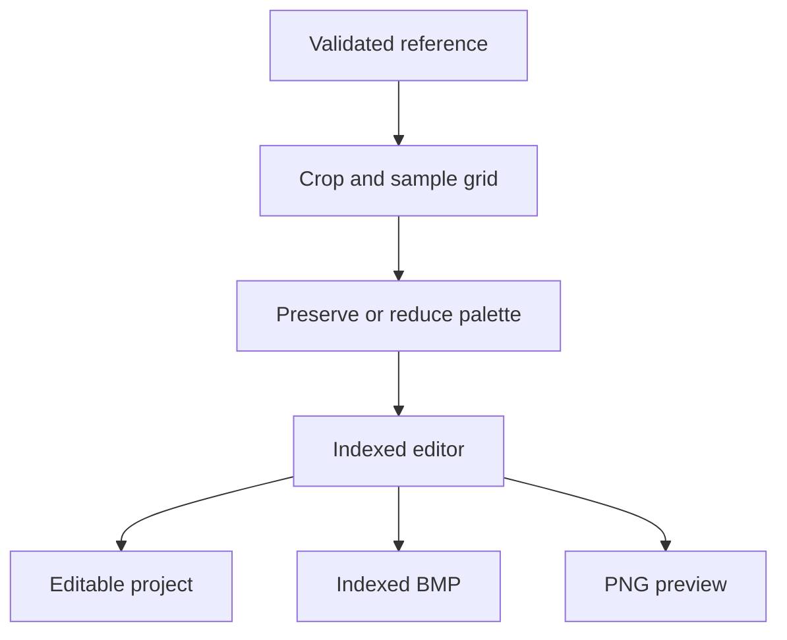

# Screenshot to editable saree design: research and implementation

Research date: 14 November 2026. Scope: recover editable color-area artwork and provide an indexed BMP handoff. Machine-specific card punching remains a separate stage.

## Repository assessment

| Candidate | Observed implementation | Decision |
|---|---|---|
| `BalajiKoushik01/SJDAS` | PyQt desktop UI, FastAPI modules, image ingestors, palette tools and loom exporters. Several routes/tools remain mocked or placeholders. `sj_das/weaves/loom_exporter.py` uses OpenCV writes and describes simulated EP output. | Useful future desktop/domain integration, but not the shortest reliable web feature path. No changes made here. |
| WeaveCore | Accessible-repository search found no separate repository by this name. `screenshot_to_design` calls its frontend `weavecore-frontend` and contains the WeaveCore PRD/spec/ML strategy. | Treat as the product within the screenshot repository, not a third confirmed codebase. |
| `BalajiKoushik01/screenshot_to_design` | React/Vite/Fabric interface, FastAPI pipeline, sample indexed and binary BMPs, extraction experiments. `dynamic_extractor.py` can synthesize fallback motifs, force symmetry, normalize motif sizes and add tie-down pixels. | Selected. Added an independent faithful extraction path and made its editor the default. Existing research work remains separately accessible. |

## Problem decomposition

A screenshot of a CAD drawing, a photo of a flat saree, and a photo of draped silk are three different inverse problems.

1. **CAD screenshot:** recover crop, pixel-grid origin, zoom, dimensions and limited palette. Exact recovery is possible only if the screenshot retained the relevant cells/colors and geometry is supplied correctly.
2. **Flat textile photo:** separate illumination/material appearance from artwork, rectify geometry, estimate repeats and reduce color regions. Even a visually plausible result can change small motifs. Designer correction is necessary.
3. **Draped or occluded textile:** recover non-planar geometry and missing design information. Multiple distinct original designs can explain the same image. No algorithm can guarantee recovery of information never observed.

A higher-resolution generated image is not evidence of a more faithful design. The adopted objective is to preserve observed structure, disclose transformation and make each cell correctable. Missing areas are not automatically synthesized in this release.

## What the primary references imply

| Resource | Relevant finding | Design consequence |
|---|---|---|
| [ArahPaint product documentation](https://www.arahne.si/products/arahpaint/) | Industry drawing workflow uses indexed colors, repeats, layers, pixel correction and explicit color reduction. | Build an indexed editing core and repeat inspection, rather than treating the final RGB preview as the master. |
| [ArahPaint manual](https://www.arahne.eu/pdf/apaint.pdf) | Scans need color reduction; repeat construction and drawing are dedicated operations. | Expose reduction, crop and repetition as designer decisions. |
| [ArahWeave scanned-picture tutorial](https://www.arahne.si/tutorials/simple-damask-with-arahweave-software-for-weaving/) | Crop a repeat, establish ends/density, then assign weave structures. | Grid dimensions and color-area design precede weave conversion. Never claim BMP alone encodes a complete controller program. |
| [ArahWeave label tutorial](https://www.arahne.si/tutorials/making-a-label-with-arahweave/) | Indexed artwork and selected weaves are separate steps in Jacquard conversion. | Preserve indices and keep machine-specific weave assignment outside this extraction feature. |
| [OpenCV geometric transformations](https://docs.opencv.org/4.x/da/d54/group__imgproc__transform.html) | Inverse coordinate mapping and interpolation determine sampled pixels; perspective is a planar transform. | Validate a clockwise convex quadrilateral, use explicit pixel-center coordinates, nearest-neighbor interpolation and exact target dimensions. |
| [Pillow image API](https://pillow.readthedocs.io/en/stable/reference/Image.html) | Palette-mode images, quantization and explicit dither choices are supported. | Preserve P-mode bytes where possible; opt into median-cut reduction without dithering. |
| [Pillow file formats](https://pillow.readthedocs.io/en/stable/handbook/image-file-formats.html) | BMP supports paletted images; supported codecs have format-specific behavior. | Decode content rather than trusting extensions and independently inspect export structure. |
| [Microsoft BITMAPINFOHEADER](https://learn.microsoft.com/en-us/windows/win32/api/wingdi/ns-wingdi-bitmapinfoheader) | Dimensions, bit depth, compression, row direction and palette entries are explicit binary fields. | Test byte-level export header, RGBQUAD ordering, bottom-up rows and padding. |
| [Identity-preserving garment restoration research](https://www.sciencedirect.com/science/article/pii/S0925231226023295) | Fine-detail identity, occlusion and training-domain mismatch remain challenges in garment restoration. | A generative restoration model is an optional future proposal tool, not the authoritative pixel source. |
| [Single-image woven-cloth reconstruction research](https://onlinelibrary.wiley.com/doi/full/10.1111/cgf.70243) | Estimates physical weave/appearance parameters from close-up cloth using inverse rendering. | Relevant to a future material/weave module; not evidence of recovering arbitrary full-saree motif artwork. |

The resource list informs architecture, not a claim that those products or papers validate this implementation. No third-party dataset/model weights are bundled and no training was performed.

## Implemented architecture

The pixel matrix is authoritative. Palette recoloring never recomputes that matrix. Duplicate-color palette entries remain distinct. Flood fill operates on indices, not approximate RGB values. Export writes the current index bytes directly; it never requantizes a canvas screenshot.

Extraction is a stateless, bounded synchronous endpoint. Expensive work runs in FastAPI's worker thread pool, limited to two concurrent extractions per process. The standalone server imports no legacy AI models, Celery state or static exports. PNG preview and project/BMP download happen client-side. This reduces operational dependencies but is not a full multi-tenant SaaS architecture.

## Fidelity evidence and limits

The benchmark derives screenshots from all ten repository BMP samples. It scales them by 2× using nearest-neighbor sampling, adds simulated application margins, and extracts with known corners and original dimensions. All ten PNG cases reconstruct **100% of RGB pixels exactly** with zero RGB MAE. Original P-mode BMP ingestion separately preserves index bytes, including duplicate-color slots.

The same constructed screenshots encoded as JPEG quality 85 and reduced to the source color count have a mean RGB MAE of approximately **12.62/255**, averaged equally over ten samples. Exact RGB agreement can be zero even where geometry looks similar because quantized palette colors change. This is evidence of loss, not a quality target or evidence of textile-photo reconstruction performance.

See `BENCHMARK_RESULTS.json` for each case. Timings are one local run, not a latency SLA. The sample set is small and includes related/binary patterns; it is not representative of all silk sarees. No paired real photograph/original CAD dataset or loom/controller was available for acceptance testing.

## Deliberate limits

- Output capped at four million pixels and 16,384 per side; process panels/repeats for larger designs.
- No automatic fabric unfolding, hidden-motif recovery, trained segmentation, super-resolution or semantic layer reconstruction.
- Named rectangular panels are editing regions, not independently composited layers.
- Color reduction uses median cut; it does not identify real yarn colors or remove silk lighting.
- Repeat preview and edge mismatch are diagnostics; no automatic repeat-period inference or seam correction.
- Input is single-frame opaque raster imagery; transparent or multi-frame sources need preparation.
- Float/interlacement checks are intentionally absent until weave structures and factory parameters exist.
- No PSD/PSP layer writer. Indexed BMP is the interoperable editable raster; JSON retains app metadata.
- Local browser history is bounded. Source imagery and history are not embedded in saved projects.
- Browser raster operations run on the main thread. Worker/tile-based rendering is the next scaling step.

## Next engineering gates

1. **Designer acceptance corpus:** obtain permissioned pairs of original CAD/BMP and screenshots/photos across borders, pallu, zari, meena and asymmetric motifs. Split by original design to avoid train/test leakage. Record source resolution, crop, zoom, original grid, compression and visibility masks.
2. **Measure the right losses:** exact index agreement for indexed sources; palette-aligned cell disagreement for screenshots; edge precision/recall, one-cell line retention, connected-component changes and repeat-offset error. Report observed versus occluded regions separately.
3. **Assisted calibration:** propose grid spacing/phase and repeat candidates using autocorrelation/registration. Require preview and designer acceptance. Compare against manual calibration on held-out designs.
4. **Controlled repair:** sample intact matching repeats for damaged areas, retain repair masks and provenance, and allow reject/undo. Evaluate geometrical copy repair before adding generative models.
5. **Photo-specific reconstruction:** test illumination normalization and region segmentation independently, protecting thin lines. Train only once enough paired saree data exists. Preserve the faithful baseline for comparison.
6. **Production web service:** authenticated projects, durable storage, per-tenant quotas, reverse-proxy body limits, isolated work queues, logs, retention/deletion, backups, performance budgets and browser workers.
7. **Factory acceptance:** get actual output profiles, accepted sample files, palette/weave mappings, hook/pick orientation and controller constraints. Verify downstream CAD import, then a supervised sample weave. Certify compatibility only for tested profiles.

A complete arbitrary-photo-to-machine-program product requires these empirical gates. This change delivers the bounded, editable extraction/export workflow and makes its limitations testable.
